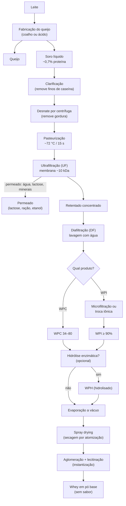
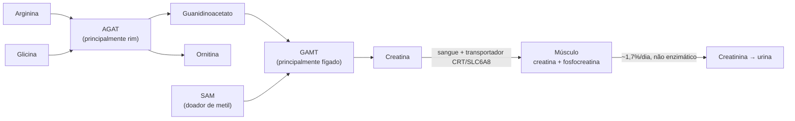
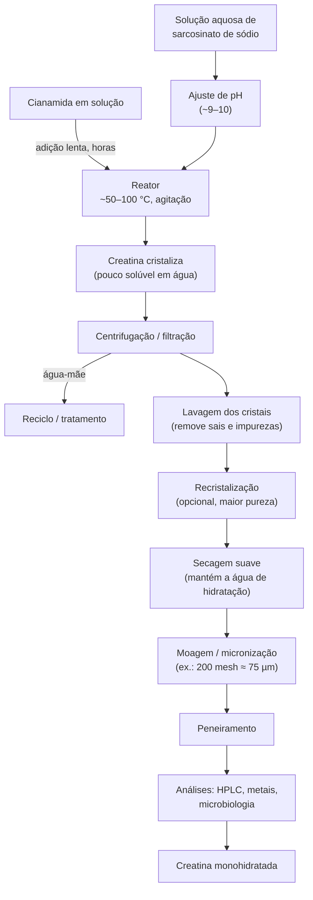
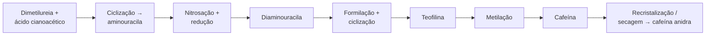
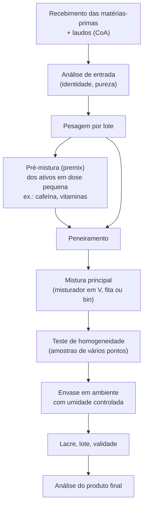
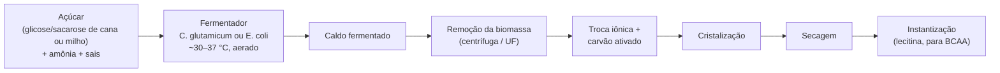
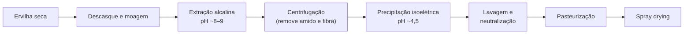
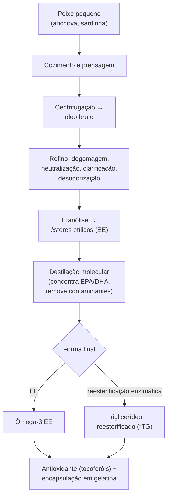

# Etapa 1 — Obtenção e processamento dos suplementos mais populares

> **Objetivo da etapa:** entender, do começo ao fim, **de onde vem** cada suplemento (matéria-prima e rota de obtenção) e **como ele é processado** até virar o pó (ou a cápsula) que chega ao consumidor.
>
> **Escopo:** whey protein, creatina, pré-treino (e cada um dos ingredientes dele) e outros populares: BCAA/glutamina, colágeno, albumina, proteínas vegetais, carboidratos, ômega-3 e vitaminas.
>
> ⚠️ Material de estudo (biologia, bioquímica e tecnologia de alimentos). Não é prescrição: dose e uso de suplemento são com nutricionista ou médico.

---

## Sumário

1. [As 4 grandes rotas de obtenção](#1-as-4-grandes-rotas-de-obtenção)
2. [Mapa geral: suplemento × rota](#2-mapa-geral-suplemento--rota)
3. [Whey protein](#3-whey-protein)
4. [Creatina](#4-creatina)
5. [Pré-treino](#5-pré-treino)
6. [Outros suplementos populares](#6-outros-suplementos-populares)
7. [Fabricação do produto final (comum a todos)](#7-fabricação-do-produto-final-comum-a-todos)
8. [Controle de qualidade e fraudes comuns](#8-controle-de-qualidade-e-fraudes-comuns)
9. [Regulação no Brasil (visão geral)](#9-regulação-no-brasil-visão-geral)
10. [Glossário](#10-glossário)
11. [Referências](#11-referências)

---

## 1. As 4 grandes rotas de obtenção

Praticamente todo suplemento sai de uma (ou de uma mistura) destas rotas:

| Rota | Como funciona | Exemplos |
|---|---|---|
| **Extração / fracionamento de matriz natural** | Parte de um alimento ou subproduto (leite, ovo, couro, peixe, ervilha) e separa a fração de interesse por processos físicos (centrifugação, filtração por membrana, precipitação, secagem). | Whey, albumina, colágeno, proteína de ervilha, óleo de peixe |
| **Síntese química** | Reações químicas a partir de matérias-primas simples (muitas de origem petroquímica ou mineral), seguidas de cristalização e purificação. | Creatina, cafeína sintética, taurina, beta-alanina (rota química) |
| **Fermentação (biotecnologia)** | Microrganismos (bactérias, leveduras, microalgas), muitas vezes melhorados geneticamente, transformam açúcar + nitrogênio no composto desejado, que depois é purificado. | BCAA, glutamina, arginina, citrulina, vitamina B12, DHA de alga |
| **Conversão enzimática** | Uma enzima isolada converte uma molécula barata em outra mais valiosa, em condições suaves. | Whey hidrolisado, colágeno hidrolisado, maltodextrina, beta-alanina (rota enzimática), L-teanina |

> 💡 **Ponto-chave de biologia:** "natural" ou "sintético" não diz nada sobre qualidade. A creatina sintética é *idêntica* à creatina da carne; o que importa é **pureza** e **ausência de contaminantes**.

---

## 2. Mapa geral: suplemento × rota

| Suplemento | Matéria-prima principal | Rota dominante | Etapa crítica do processo | Onde se concentra a produção mundial |
|---|---|---|---|---|
| Whey protein | Soro do leite (subproduto do queijo) | Extração + filtração por membrana | Ultrafiltração / diafiltração e secagem sem desnaturar | EUA, UE, Nova Zelândia, Argentina |
| Creatina | Sarcosinato de sódio + cianamida | Síntese química | Controle de pH/temperatura e cristalização (impurezas) | China (maioria), Alemanha |
| Cafeína anidra | Ureia/derivados petroquímicos **ou** café/chá | Síntese química (maioria) ou extração | Purificação/recristalização | China, Índia |
| Beta-alanina | Acrilonitrila/ácido acrílico + amônia **ou** L-aspartato | Síntese química ou enzimática | Purificação e cristalização | China |
| L-citrulina | Açúcar (glicose/sacarose) | Fermentação | Separação do caldo e cristalização | Ásia (Japão, China, Coreia) |
| Taurina | Óxido de etileno ou monoetanolamina | Síntese química | Remoção de sais (sulfato de sódio) | China |
| BCAA / glutamina | Açúcar + amônia | Fermentação (*Corynebacterium glutamicum*) | Purificação por troca iônica | China, Japão, Coreia |
| Colágeno hidrolisado | Couro/ossos bovinos, pele suína, pele de peixe | Extração + hidrólise enzimática | Pré-tratamento e hidrólise controlada | Brasil (bovino), Europa, Ásia |
| Albumina | Clara de ovo | Extração + secagem | Dessacarificação e pasteurização | Brasil, EUA, UE |
| Proteína de ervilha | Ervilha seca | Extração alcalina + precipitação isoelétrica | Precipitação e secagem | China, Europa, Canadá |
| Maltodextrina / dextrose | Amido de milho ou mandioca | Hidrólise enzimática | Controle do grau de hidrólise (DE) | Global |
| Ômega-3 | Peixes (anchova, sardinha) ou microalgas | Extração + refino (ou fermentação) | Refino, destilação molecular, controle de oxidação | Peru/Chile (peixe), EUA/UE (alga) |

---

## 3. Whey protein

### 3.1 O que é

**Whey** = proteína do **soro do leite**. O leite tem dois grupos de proteínas:

- **Caseínas (~80%)**: formam o coágulo do queijo.
- **Proteínas do soro (~20%)**: ficam dissolvidas no líquido que sobra.

Na fabricação do queijo, o coalho (enzima quimosina) ou um ácido coagula a caseína. O líquido amarelado que escorre é o **soro**. Para cada **1 kg de queijo** sobram cerca de **9 litros de soro**. Antigamente ele era descartado (poluente forte, alta demanda biológica de oxigênio); hoje é a matéria-prima de uma indústria bilionária.

**Composição típica do soro líquido:**

| Componente | Teor aproximado |
|---|---|
| Água | ~93–94% |
| Lactose | ~4,5–5% |
| Proteína | ~0,6–0,8% |
| Minerais (cinzas) | ~0,5–0,7% |
| Gordura | ~0,1–0,3% |

> Ou seja: é preciso processar **muita água** para obter pouca proteína. Todo o desafio tecnológico do whey é **separar a proteína da água, da lactose e dos minerais sem estragar a proteína**.

**Principais proteínas do soro:**

| Proteína | % aproximada | Destaque |
|---|---|---|
| β-lactoglobulina | ~50% | Rica em leucina e aminoácidos essenciais; principal alergênico do soro |
| α-lactalbumina | ~20% | Rica em triptofano e cisteína |
| Glicomacropeptídeo (GMP) | ~15–20% (só no soro doce) | Fragmento da κ-caseína liberado pelo coalho |
| Imunoglobulinas | ~10% | Anticorpos |
| Albumina sérica bovina | ~5% | — |
| Lactoferrina | ~1–2% | Liga ferro, ação antimicrobiana |

O whey tem **~10–11% de leucina**, o aminoácido mais associado ao estímulo da síntese proteica muscular (via mTOR).

**Tipos de soro:**

- **Soro doce** (pH ~6–6,5): vem de queijos feitos com coalho (muçarela, prato, cheddar). É o preferido para whey.
- **Soro ácido** (pH < 5): vem de queijos/derivados coagulados por ácido (cottage, quark, iogurte grego). Mais difícil de processar (mais minerais e ácido lático).

### 3.2 Fluxograma de produção



### 3.3 Etapas em detalhe

1. **Recepção e resfriamento do soro**
   O soro estraga rápido (bactérias fermentam a lactose). Precisa ser resfriado (< 7 °C) e processado em poucas horas.

2. **Clarificação**
   Centrífugas ou peneiras removem os "finos de caseína" (pedacinhos de coalho) que entupiriam as membranas.

3. **Desnate**
   Uma centrífuga separadora retira a gordura residual (gera o "creme de soro", usado em manteiga). Gordura atrapalha a filtração e oxida durante o armazenamento.

4. **Pasteurização**
   Tratamento térmico suave (tipo HTST, ~72 °C por ~15 s) para matar patógenos. **Não pode exagerar**: as proteínas do soro começam a desnaturar acima de ~70–75 °C.

5. **Ultrafiltração (UF)** — *coração do processo*
   O soro é bombeado sob pressão através de membranas com poros minúsculos (corte de ~10 kDa).
   - **Fica retido (retentado):** proteína (moléculas grandes).
   - **Passa (permeado):** água, lactose, minerais.
   Quanto mais se concentra, maior o % de proteína no extrato seco.

6. **Diafiltração (DF)**
   Adiciona-se água ao retentado e filtra-se de novo, "lavando" a lactose e os minerais que sobraram. É o que leva o concentrado de ~35% para ~80% de proteína.

7. **Purificação adicional (só para isolado — WPI)**, por uma de duas rotas:
   - **Microfiltração (MF):** membranas mais abertas (~0,1–1,4 µm) que removem gordura residual, fosfolipídios e bactérias, seguida de UF/DF. Preserva bem as frações proteicas.
   - **Troca iônica:** o soro passa por uma coluna com resina que "gruda" as proteínas pela carga elétrica; depois elas são liberadas (eluídas) mudando pH/sal. Gera proteína muito pura, mas pode alterar a proporção das frações (ex.: perde parte do GMP e da lactoferrina).

8. **Hidrólise enzimática (só para hidrolisado — WPH)**
   Enzimas proteases (ex.: alcalase, tripsina, papaína) "picotam" as proteínas em peptídeos menores. O processo é controlado pelo **grau de hidrólise (GH)** e interrompido por aquecimento (inativa a enzima). Resultado: absorção mais rápida e menos alergenicidade, mas **sabor amargo** (peptídeos hidrofóbicos) e custo maior.

9. **Evaporação**
   Evaporadores de filme descendente a **vácuo** retiram água em baixa temperatura (a pressão baixa faz a água ferver a ~50–70 °C).

10. **Secagem por atomização (spray drying)**
    O concentrado é pulverizado em gotículas finíssimas dentro de uma câmara com ar quente (entrada ~160–200 °C, saída ~70–90 °C). A água evapora em segundos e a gota vira partícula de pó. A evaporação "resfria" a partícula, por isso a proteína não desnatura apesar do ar quente.

11. **Instantização**
    - **Aglomeração:** junta partículas finas em grânulos porosos (dissolve melhor, menos pó voando).
    - **Lecitinação:** cobre o pó com lecitina (soja ou girassol) para ele "molhar" e dispersar sem empelotar.

12. **Saborização e envase** → ver [seção 7](#7-fabricação-do-produto-final-comum-a-todos).

**Subprodutos aproveitados:** o **permeado** (água + lactose + minerais) vira lactose em pó, permeado em pó para ração, base para bebidas, ou é fermentado para etanol/biogás. Nada se perde.

### 3.4 Tipos de whey

| Tipo | Proteína (base seca) | Lactose | Gordura | Como é feito | Observação |
|---|---|---|---|---|---|
| **WPC 34** | ~34% | alta | média | UF leve | Usado em alimentos (iogurte, panificação) |
| **WPC 80** ("concentrado") | ~80% | ~4–8% | ~4–7% | UF + DF | O "whey padrão" mais vendido |
| **WPI** ("isolado") | ≥ 90% | < 1–2% | < 1% | UF/DF + MF ou troca iônica | Melhor para quem tem baixa tolerância à lactose |
| **WPH** ("hidrolisado") | 80–90%+ | baixa | baixa | Hidrólise enzimática de WPC/WPI | Mais caro e mais amargo |
| **Whey nativo** | 80–90%+ | baixa | baixa | Microfiltração **direto do leite** (não vem do queijo) | Menos tratamento térmico; sem GMP |
| **"3W" / blend** | variável | variável | variável | Mistura de WPC + WPI + WPH | Marketing; olhar a % real de proteína na tabela |

### 3.5 Pontos críticos

- **Desnaturação:** calor excessivo em qualquer etapa reduz solubilidade e funcionalidade.
- **Reação de Maillard:** lactose + lisina reagem com o tempo e calor (escurecimento, perda de lisina disponível). Isolado, por ter menos lactose, é mais estável.
- **Higiene das membranas:** limpeza CIP (*clean-in-place*) diária com soluções alcalinas, ácidas e enzimáticas.
- **Rendimento:** a planta precisa estar perto de grandes laticínios (soro não viaja bem).

---

## 4. Creatina

### 4.1 O que é e de onde vem no corpo

**Creatina** (ácido metilguanidinoacético) é um composto nitrogenado que, na forma de **fosfocreatina**, regenera ATP rapidamente nos primeiros segundos de esforço intenso (sistema ATP-CP).

- Um adulto de ~70 kg tem cerca de **120–140 g** de creatina, **~95% no músculo esquelético**.
- O corpo **produz ~1 g/dia** e uma dieta onívora fornece ~1 g/dia.
- Cerca de **1,5–2%** do estoque vira **creatinina** por dia (reação não enzimática) e sai na urina — por isso a creatinina é usada como marcador de função renal.

**Biossíntese (biologia pura):**



### 4.2 Fontes naturais

| Alimento (cru) | Creatina aproximada |
|---|---|
| Carne bovina | ~4–5 g/kg |
| Carne suína | ~5 g/kg |
| Salmão | ~4,5 g/kg |
| Arenque | ~6,5–10 g/kg |
| Vegetais | praticamente zero |

Para ingerir 3–5 g/dia só com comida seria preciso ~1 kg de carne por dia. **Extrair** creatina de carne não é viável economicamente → por isso a indústria usa **síntese química**.

### 4.3 Rota industrial (síntese química)

A reação central é simples:

```
Cianamida (H₂N–C≡N)  +  Sarcosinato de sódio (CH₃–NH–CH₂–COONa)
                    ⟶  Creatina  (H₂N–C(=NH)–N(CH₃)–CH₂–COOH)
```

A cianamida "encaixa" o grupo guanidino no nitrogênio da sarcosina (N-metilglicina).

**De onde vêm as matérias-primas:**

- **Cianamida:**
  1. Calcário (CaCO₃) → cal (CaO).
  2. CaO + coque em forno elétrico a ~2000 °C → **carbeto de cálcio** (CaC₂).
  3. CaC₂ + nitrogênio do ar a ~1000 °C → **cianamida cálcica** (CaCN₂) — *processo Frank-Caro*, o mesmo que gerou um dos primeiros fertilizantes nitrogenados.
  4. CaCN₂ + água + CO₂ → **cianamida** em solução + CaCO₃.
- **Sarcosinato de sódio:**
  - Formaldeído + metilamina + cianeto → metilaminoacetonitrila → hidrólise com NaOH → sarcosinato de sódio (rota tipo Strecker); **ou**
  - Ácido cloroacético + metilamina.

**Fluxograma:**



**Detalhes que fazem diferença:**

- **pH e temperatura:** patentes descrevem a reação entre 20 e 150 °C e pH 7–14; na prática, pH levemente alcalino e temperatura moderada. Fora da faixa ideal aumentam as impurezas.
- **Adição lenta da cianamida:** cianamida concentrada tende a reagir com ela mesma formando **diciandiamida** (dímero) ou com água formando **ureia**.
- **Cristalização:** a creatina é pouco solúvel (~14 g/L a 20 °C), então ela precipita sozinha. O controle do resfriamento define o tamanho do cristal (cristais muito finos dificultam filtração e lavagem).
- **Monohidratada:** cada molécula cristaliza com uma molécula de água. **1 g de creatina monohidratada = ~0,88 g de creatina.**
- **Micronização:** só reduz o tamanho da partícula (dispersa melhor na água). **A molécula é a mesma.**

### 4.4 Impurezas que importam

| Impureza | Origem | Por que importa |
|---|---|---|
| **Creatinina** | Ciclização da creatina (favorecida por calor e pH ácido) | Inativa; indica degradação ou processo ruim |
| **Diciandiamida (DCD)** | Dímero da cianamida | Sem benefício; indicador de controle de processo |
| **Di-hidrotriazina (DHT)** | Subproduto da síntese | Toxicologia pouco estudada; produtos premium declaram ausência |
| Sarcosina residual / sais | Matéria-prima não reagida, lavagem insuficiente | Reduz pureza |
| Metais pesados | Matérias-primas e equipamentos | Segurança |

> A referência de qualidade do mercado é **pureza ≥ 99,9% por HPLC**. Marcas que usam matéria-prima com certificação de terceiros (ex.: Creapure®, produzida na Alemanha) publicam laudos com limites dessas impurezas.

### 4.5 Formas no mercado

| Forma | O que é | Evidência científica |
|---|---|---|
| **Monohidratada** | A forma clássica | **Padrão-ouro**: centenas de estudos |
| Micronizada | Monohidratada com partícula menor | Igual à monohidratada (só dissolve melhor) |
| Anidra | Sem a água de cristalização (~100% creatina) | Equivalente, mais cara |
| HCl (cloridrato) | Sal com ácido clorídrico, mais solúvel | Sem vantagem comprovada sobre a monohidratada |
| Tamponada (Kre-Alkalyn®) | Monohidratada com pH alcalino | Sem vantagem comprovada |
| Etil éster | Esterificada | **Pior**: degrada em creatinina no organismo |

### 4.6 Rota do futuro: fermentação

Há pesquisa com microrganismos (ex.: *E. coli* e *C. glutamicum*) modificados com os genes **AGAT** e **GAMT** para produzir creatina a partir de açúcar, imitando a biossíntese humana. Ainda é escala de laboratório/piloto.

> 🌱 Curiosidade: toda creatina sintética já é **vegana** (nenhuma matéria-prima animal).

---

## 5. Pré-treino

### 5.1 O que é

O pré-treino **não é uma substância**: é uma **formulação** (mistura) de vários ingredientes com funções diferentes. Por isso, entender o pré-treino = entender a obtenção de **cada ingrediente** + o processo de **mistura**.

### 5.2 Ingredientes típicos

| Ingrediente | Função proposta | Dose usual estudada* | Rota de obtenção |
|---|---|---|---|
| **Cafeína anidra** | Estimulante (antagonista de adenosina): alerta, menos percepção de esforço | 3–6 mg/kg | Síntese química (maioria) ou extração |
| **Beta-alanina** | Aumenta carnosina muscular (tampão de ácido) | 3,2–6,4 g/dia (efeito crônico) | Síntese química ou enzimática |
| **L-citrulina / citrulina malato** | Aumenta arginina → óxido nítrico ("pump") | 3–6 g (citrulina) / 6–8 g (malato) | Fermentação |
| **L-arginina** | Precursor de óxido nítrico | 3–6 g | Fermentação |
| **Taurina** | Osmólito, função muscular e neural | 1–3 g | Síntese química |
| **Betaína (TMG)** | Osmólito, doador de metil | ~2,5 g | Extração (melaço de beterraba) ou síntese |
| **Nitrato (extrato de beterraba)** | Fonte de óxido nítrico | ~6–8 mmol nitrato | Extração e concentração do suco |
| **L-tirosina** | Precursor de dopamina/noradrenalina | 0,5–2 g | Fermentação ou hidrólise de proteína |
| **L-teanina** | "Suaviza" efeito da cafeína | 100–200 mg | Síntese enzimática ou extração do chá |
| **Creatina** | Força/potência (efeito crônico) | 3–5 g/dia | Síntese química |
| **Vitaminas do complexo B** | Metabolismo energético | — | Síntese ou fermentação |

\*Faixas citadas em posicionamentos científicos (ISSN). Os limites legais por porção são definidos pela ANVISA (ver [seção 9](#9-regulação-no-brasil-visão-geral)).

### 5.3 Cafeína

**Duas origens:**

**a) Extração (cafeína "natural")**
É principalmente **subproduto da descafeinação** de café e chá:
- **CO₂ supercrítico:** CO₂ sob alta pressão (~ 70–300 bar) age como solvente seletivo da cafeína.
- **Água + carvão ativado** (processo "Swiss Water").
- **Solventes orgânicos:** acetato de etila ou diclorometano.

A cafeína bruta recuperada é purificada por recristalização e/ou **sublimação** (a cafeína passa direto de sólido para gás e recondensa pura).
Fontes vegetais usadas em suplementos: **guaraná** (semente com ~2,5–6% de cafeína — bem mais que o café), café verde, chá verde, erva-mate.

**b) Síntese química (maior parte do mercado mundial)**
A rota clássica é a **síntese de Traube** de purinas:



> 🔬 **Como saber se a cafeína é natural ou sintética?** A molécula é idêntica, mas a **assinatura isotópica** não: cafeína de origem petroquímica não tem **carbono-14** (o petróleo é antigo demais) e tem proporção ¹³C/¹²C diferente. Laboratórios usam isso para flagrar "cafeína natural" que na verdade é sintética.

### 5.4 Beta-alanina

É um **β-aminoácido** (o grupo amino fica no carbono β). No músculo, junta-se com histidina para formar **carnosina**, que tampona íons H⁺ em esforços de 1–4 minutos. O famoso **formigamento (parestesia)** vem da ativação de receptores sensoriais (MrgprD) na pele — inofensivo.

**Obtenção:**
- **Química:** acrilonitrila + amônia → β-aminopropionitrila → hidrólise → beta-alanina; ou ácido acrílico + amônia sob pressão e temperatura.
- **Enzimática/biotecnológica (crescente):** a enzima **L-aspartato-α-descarboxilase (PanD)** remove o CO₂ do L-aspartato → beta-alanina. Condições suaves, menos resíduos.

Depois: purificação (troca iônica/carvão ativado), cristalização, secagem e moagem.

### 5.5 L-citrulina e citrulina malato

A citrulina é um aminoácido do **ciclo da ureia**. Tomada por via oral, ela é convertida em **arginina** nos rins e aumenta mais a arginina no sangue do que a própria arginina (que é muito degradada no intestino e fígado).

- **Fonte natural:** a melancia (*Citrullus lanatus*, daí o nome), mas em baixa concentração (da ordem de 1–3 g por kg de fruta).
- **Obtenção industrial:**
  - **Fermentação** com bactérias (ex.: *Corynebacterium glutamicum*) modificadas para acumular citrulina; **ou**
  - **Conversão enzimática** de L-arginina pela enzima **arginina deiminase**.
- **Citrulina malato:** combinação de citrulina com **ácido málico** (proporção 1:1 ou 2:1). O ácido málico vem da hidratação do anidrido maleico (rota petroquímica, forma DL) ou de fermentação (forma L).

### 5.6 Taurina

Aminoácido sulfonado (tem enxofre na forma de ácido sulfônico).

> 🐂 **Mito:** taurina **não** vem de touro. O nome vem de *Bos taurus* porque foi isolada pela primeira vez da **bile de boi** em 1827. Toda taurina de suplemento e energético é **sintética**.

**Rotas industriais:**

1. **Óxido de etileno:** óxido de etileno + bissulfito de sódio → isetionato de sódio → amonólise (amônia, alta pressão e temperatura) → taurato de sódio → acidificação → taurina.
2. **Monoetanolamina (MEA):** MEA + ácido sulfúrico → sulfato de 2-aminoetila → reação com sulfito de sódio → taurina + sulfato de sódio.

A etapa mais trabalhosa é **separar a taurina dos sais** (cristalização fracionada).

### 5.7 Outros ingredientes

- **L-arginina e L-tirosina:** fermentação bacteriana a partir de açúcar (mesma lógica dos BCAA, ver [6.1](#61-bcaa-e-glutamina)).
- **Betaína:** extraída do **melaço/vinhaça da beterraba açucareira** por cromatografia industrial; ou sintetizada (trimetilamina + ácido cloroacético).
- **Nitrato de beterraba:** suco de beterraba → filtração → concentração a vácuo → secagem (pó padronizado em nitrato).
- **L-teanina:** síntese enzimática a partir de glutamina + etilamina (enzima γ-glutamil transferase) ou extração das folhas de chá.

### 5.8 Como o pré-treino é fabricado



**Pontos críticos específicos do pré-treino:**

- **Homogeneidade da cafeína:** é um ativo potente em dose pequena (ex.: 200 mg em 10 g de pó = 2%). Se a mistura não for homogênea, um *scoop* pode vir com muito mais cafeína que outro. Por isso se faz **premix** (diluição progressiva) antes da mistura principal.
- **Higroscopicidade:** citrulina malato, betaína e alguns ácidos absorvem umidade e **empedram**. Usa-se antiumectante (ex.: dióxido de silício) e envase com umidade relativa controlada.
- **Aditivos:** acidulantes (ácido cítrico/málico), aromas, edulcorantes (sucralose, acessulfame-K, estévia), corantes, espessantes.

**Riscos e proibições:**

- **Estimulantes proibidos:** o **DMAA** (1,3-dimetilamilamina) é proibido pela ANVISA desde 2012; análogos como DMHA também são problemáticos. Já houve pré-treinos importados com essas substâncias.
- **"Blend proprietário":** fórmulas que escondem a dose de cada ingrediente. No Brasil a rotulagem deve declarar as quantidades.
- **Doping:** contaminação cruzada em fábricas que também produzem estimulantes. Atletas testados devem preferir produtos com certificação de terceiros (ex.: programas tipo *Informed Sport* / *NSF Certified for Sport*).

---

## 6. Outros suplementos populares

### 6.1 BCAA e glutamina

**BCAA** = leucina, isoleucina e valina (proporção comum 2:1:1). **Glutamina** = aminoácido não essencial mais abundante no sangue.

**Rota atual: fermentação**



- A bactéria ***Corynebacterium glutamicum*** foi descoberta no Japão (anos 1950) produzindo glutamato e virou a "fábrica viva" da indústria de aminoácidos. Linhagens são melhoradas por mutação e engenharia genética para **superproduzir** um aminoácido específico (desligando retroalimentação negativa das enzimas).
- **Rota antiga:** hidrólise ácida de **queratina** (cabelo, penas). Ainda existe no mercado de aminoácidos, o que explica rótulos como "BCAA vegano/fermentado".
- **Curiosidade:** leucina é **pouco solúvel** e "boia" na água — por isso o BCAA é instantizado com lecitina.

### 6.2 Colágeno hidrolisado

- **Matéria-prima:** couro e ossos bovinos (o Brasil, com rebanho enorme, é grande produtor), pele suína, pele e escamas de peixe.
- **Processo:**
  1. **Pré-tratamento:**
     - alcalino (cal, por semanas) → gelatina tipo B, típico do couro bovino;
     - ácido (horas a dias) → gelatina tipo A, típico da pele suína.

     O pré-tratamento "afrouxa" as ligações cruzadas da tripla hélice do colágeno.
  2. **Extração com água quente** em estágios (~50 → 100 °C) → solução de **gelatina**.
  3. **Filtração, troca iônica e evaporação.**
  4. **Hidrólise enzimática** (proteases) → peptídeos pequenos (~2–5 kDa) que **não gelificam** e dissolvem a frio.
  5. Esterilização (UHT) e **spray drying**.
- **Biologia:** colágeno é rico em **glicina, prolina e hidroxiprolina**, mas **pobre em aminoácidos essenciais** (não tem triptofano). Não substitui whey para ganho muscular.

### 6.3 Albumina (clara de ovo)

1. Quebra automática dos ovos e **separação** clara/gema.
2. Filtração e homogeneização.
3. **Pasteurização** suave (~56–60 °C; acima disso a clara coagula).
4. **Dessacarificação:** retira a glicose natural da clara por fermentação (leveduras/bactérias) ou pela enzima **glicose-oxidase**. Sem isso, a glicose reage com as proteínas no pó (Maillard) e ele escurece.
5. **Spray drying.**
6. **Pasteurização a seco ("hot room"):** o pó fica dias em câmara quente (~55–70 °C) para eliminar *Salmonella* e melhorar propriedades.

### 6.4 Proteínas vegetais (ervilha, soja, arroz)

**Ervilha (isolado ~80–85% de proteína):**



- **Princípio:** proteínas são solúveis em pH alcalino e **precipitam no ponto isoelétrico** (pH em que a carga líquida é zero).
- **Soja:** o farelo desengordurado (óleo extraído com hexano) passa pelo mesmo princípio → isolado ≥ 90%.
- **Arroz:** o amido é digerido por enzimas (α-amilase) e o que sobra é concentrado proteico.
- **Biologia:** ervilha é pobre em metionina, arroz é pobre em lisina → por isso os blends **ervilha + arroz** têm perfil de aminoácidos complementar.

### 6.5 Carboidratos (maltodextrina, dextrose, palatinose, waxy maize)

Todos partem do **amido** (milho ou mandioca):

1. **Liquefação:** amido + água + **α-amilase termoestável** a ~105 °C → cadeias menores.
2. **Sacarificação:** controle do grau de hidrólise (**DE — dextrose equivalente**):
   - **Maltodextrina:** DE < 20 (hidrólise parcial).
   - **Dextrose (glicose):** hidrólise completa com **glicoamilase** (DE ~95+), depois cristalização.
3. **Refino:** carvão ativado + troca iônica.
4. **Secagem** (spray drying para maltodextrina).

- **Palatinose (isomaltulose):** obtida da **sacarose** pela enzima **sacarose isomerase** (de origem bacteriana); muda a ligação entre glicose e frutose → digestão mais lenta.
- **Waxy maize:** amido de milho ceroso (quase 100% **amilopectina**), pré-gelatinizado.
- **Hipercalórico** = mistura de carboidratos (maltodextrina/dextrose) + proteína (whey/caseína) + gorduras/vitaminas.

### 6.6 Ômega-3

**De peixe:**



- **Destilação molecular** (alto vácuo, baixa temperatura) remove **metais pesados, PCBs e dioxinas**.
- **Qualidade:** oxidação medida por índice de peróxido, anisidina e **TOTOX**. Óleo oxidado = cheiro forte de peixe ("arroto de peixe").
- **De microalgas (vegano):** a alga *Schizochytrium* é cultivada em fermentadores → óleo rico em **DHA** extraído e refinado. Curiosidade: os peixes **não produzem** ômega-3; eles acumulam ao comer algas (cadeia alimentar).

### 6.7 Vitaminas (curiosidades de obtenção)

| Vitamina | Obtenção industrial |
|---|---|
| **B12** | **Só por fermentação** bacteriana (*Pseudomonas denitrificans*, *Propionibacterium*). A síntese química total existe, mas é inviável (dezenas de etapas). Nenhum animal ou planta produz B12 — só bactérias. |
| **B2 (riboflavina)** | Fermentação (fungo *Ashbya gossypii* ou *Bacillus subtilis*). |
| **C (ácido ascórbico)** | Glicose → sorbitol → fermentação em duas etapas (bactérias) → ácido 2-ceto-L-gulônico → ácido ascórbico (sucessor do processo Reichstein). |
| **D3** | **Lanolina** (gordura da lã de ovelha) → colesterol → 7-deidrocolesterol → **irradiação UVB** → vitamina D3. Mesmo princípio da pele humana! Versão vegana: líquen. |
| **D2** | Ergosterol de leveduras/cogumelos irradiado com UV. |
| **Ácido fólico** | Síntese química. |

---

## 7. Fabricação do produto final (comum a todos)

Depois que a matéria-prima "base" está pronta (whey base, creatina pura, aminoácidos etc.), a **fábrica de suplementos** (que muitas vezes **não** produz a matéria-prima, só compra e formula) faz:

1. **Qualificação do fornecedor** e **recebimento com laudo** (CoA — certificado de análise).
2. **Quarentena e análise de entrada** (identidade, pureza, microbiologia).
3. **Pesagem** conforme a fórmula.
4. **Mistura** com aromas, edulcorantes, cacau, espessantes (goma xantana), enzimas (lactase), corantes, antiumectantes.
5. **Teste de homogeneidade.**
6. **Envase:** potes ou sachês; às vezes com **nitrogênio** para reduzir oxidação; cápsulas para ômega-3, vitaminas, cafeína.
7. **Rotulagem** com lote e validade.
8. **Liberação pelo controle de qualidade** e retenção de amostra de cada lote.

> 💡 **Insight de mercado:** a maioria das marcas brasileiras **compra** whey base, creatina e aminoácidos de fornecedores globais (EUA, Europa, América do Sul, China) e faz a formulação/envase aqui ou terceiriza para fábricas "white label".

---

## 8. Controle de qualidade e fraudes comuns

| Análise | Para quê |
|---|---|
| **Proteína (Kjeldahl ou Dumas)** | Mede o **nitrogênio** total e multiplica por um fator (6,38 para lácteos) |
| **Perfil de aminoácidos (HPLC)** | Detecta *amino spiking* e confirma a origem da proteína |
| **HPLC de creatina** | Pureza e impurezas (creatinina, DCD, DHT) |
| **Teor de cafeína (HPLC)** | Garante a dose declarada |
| **Metais pesados (ICP-MS)** | Chumbo, cádmio, mercúrio, arsênio |
| **Microbiologia** | *Salmonella*, enterobactérias, *B. cereus*, bolores/leveduras |
| **Umidade e atividade de água** | Estabilidade (pó seco não deixa micróbio crescer) |
| **Triagem de dopantes** | Estimulantes e anabolizantes não declarados |

**Fraudes recorrentes:**

- **Amino spiking (whey):** como o método mede **nitrogênio**, fabricantes desonestos adicionam aminoácidos baratos (glicina, taurina, creatina) para "inflar" o teor de proteína no laudo. O perfil de aminoácidos desmascara.
- **Whey abaixo do rótulo:** testes independentes no Brasil já encontraram vários produtos com proteína bem abaixo do declarado (ex.: completados com maltodextrina, soja ou colágeno).
- **Creatina diluída:** produtos com menos creatina que o declarado ou "cortados" com carboidratos.
- **Estimulantes ocultos** em pré-treinos e termogênicos.

---

## 9. Regulação no Brasil (visão geral)

- **RDC nº 243/2018 (ANVISA):** marco regulatório dos **suplementos alimentares** (requisitos sanitários, composição, qualidade, rotulagem).
- **IN nº 28/2018 (ANVISA):** listas de **constituintes autorizados**, **limites mínimos e máximos** por grupo populacional, **alegações** permitidas e rotulagem complementar. É atualizada com frequência (ex.: IN 275/2024, IN 284/2024 e IN 438/2026) — **sempre consultar o texto consolidado vigente** antes de usar números.
- **Exemplos do que a IN 28 regula:**
  - Alegação de creatina (força/desempenho) condicionada a **dose diária** e **pureza mínima** da creatina monohidratada (citada como ≥ 99,9%).
  - Cafeína com limites e alegação de desempenho atrelada a dose mínima por porção e público adulto (≥ 19 anos).
  - Proteínas com requisitos de qualidade (ex.: PDCAAS) para alegações.
- **Boas Práticas de Fabricação (BPF):** obrigatórias para as fábricas.
- **Referência de segurança da cafeína (EFSA, 2015):** até ~400 mg/dia para adultos saudáveis e doses únicas de até ~200 mg não geram preocupação; gestantes até 200 mg/dia.

> 📌 Para a etapa de regulação (se ela entrar no plano), vale um aprofundamento só nisso, com os anexos da IN 28 em mãos.

---

## 10. Glossário

| Termo | Significado |
|---|---|
| **UF (ultrafiltração)** | Filtração por membrana que retém proteínas e deixa passar água, açúcares e sais |
| **DF (diafiltração)** | UF com adição de água para "lavar" componentes pequenos |
| **MF (microfiltração)** | Membrana mais aberta; retém gordura, bactérias e partículas |
| **Troca iônica** | Separação por carga elétrica usando resinas |
| **Retentado / permeado** | O que fica / o que passa pela membrana |
| **Spray drying** | Secagem por atomização em ar quente |
| **Instantização** | Aglomeração + lecitinação para dissolver fácil |
| **Desnaturação** | Perda da estrutura 3D da proteína (por calor, pH etc.) |
| **Reação de Maillard** | Reação entre açúcar redutor e aminoácido (escurecimento) |
| **Grau de hidrólise (GH)** | % de ligações peptídicas quebradas |
| **DE (dextrose equivalente)** | Quanto o amido foi quebrado (0 = amido, 100 = glicose) |
| **Ponto isoelétrico** | pH em que a proteína tem carga zero e precipita |
| **HPLC** | Cromatografia líquida de alta eficiência (identifica e quantifica compostos) |
| **CoA** | Certificado de análise do lote |
| **BPF** | Boas Práticas de Fabricação |
| **Premix** | Pré-diluição de ingredientes de dose pequena para garantir homogeneidade |
| **Mesh** | Medida de peneira (200 mesh ≈ 75 µm) |

---

## 11. Referências

**Científicas e técnicas**

- Kreider RB et al. *International Society of Sports Nutrition position stand: safety and efficacy of creatine supplementation in exercise, sport, and medicine.* J Int Soc Sports Nutr, 2017.
- Guest NS et al. *International Society of Sports Nutrition position stand: caffeine and exercise performance.* J Int Soc Sports Nutr, 2021.
- Trexler ET et al. *International Society of Sports Nutrition position stand: Beta-Alanine.* J Int Soc Sports Nutr, 2015.
- Jäger R et al. *International Society of Sports Nutrition Position Stand: protein and exercise.* J Int Soc Sports Nutr, 2017.
- Moret S, Prevarin A, Tubaro F. *Levels of creatine, organic contaminants and heavy metals in creatine dietary supplements.* Food Chemistry, 2011.
- EFSA NDA Panel. *Scientific Opinion on the safety of caffeine.* EFSA Journal, 2015.
- Melnikova et al. (2024). Produção de isolado de proteína do soro por membranas cerâmicas (UF/MF/DF). *Food Systems / Пищевые системы* — https://www.fsjour.com/jour/article/view/496
- Nutraceuticals World. *Whey Protein Isolates: Production, Composition and Nutrition* — https://www.nutraceuticalsworld.com/issues/1999-03/view_features/whey-protein-isolates-production-composition-and-n/

**Patentes (processo da creatina)**

- US 5.719.319 — *Process for the preparation of a creatine or creatine monohydrate* — https://image-ppubs.uspto.gov/dirsearch-public/print/downloadPdf/5719319
- US 6.399.819 B1 — *Process for purifying creatine* — https://patents.google.com/patent/US6399819
- EP 1110947 A1 — *Verfahren zur Reinigung von Kreatin* — https://patents.google.com/patent/EP1110947

**Regulatórias (Brasil)**

- ANVISA — RDC nº 243/2018 e IN nº 28/2018 (suplementos alimentares) e alterações — https://www.gov.br/anvisa
- IN ANVISA nº 438, de 16/04/2026 (altera a IN 28/2018) — https://www.lex.com.br/instrucao-normativa-anvisa-no-438-de-16-de-abril-de-2026/
